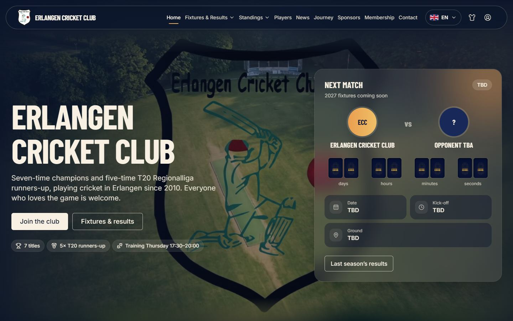
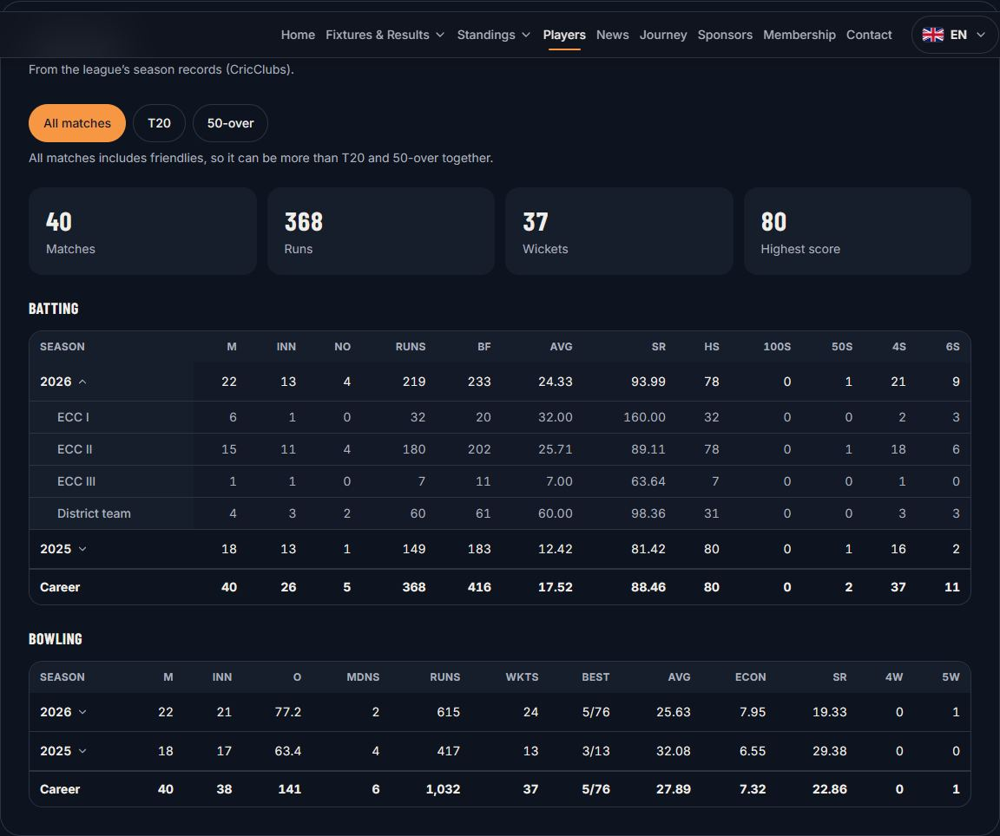
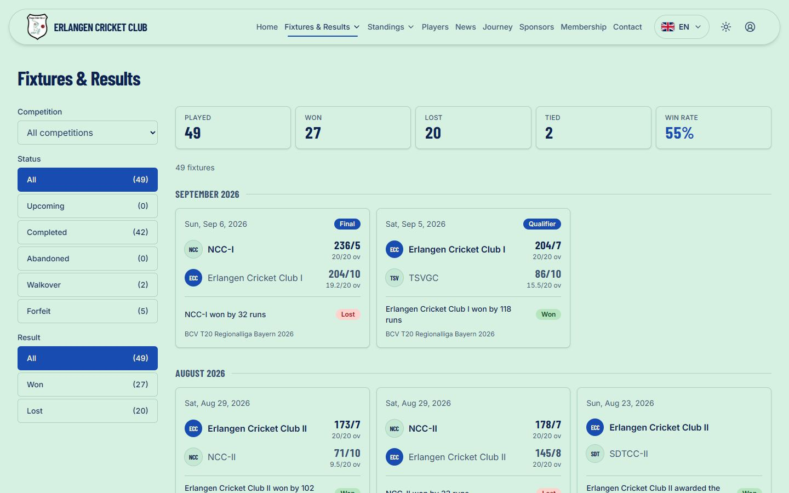
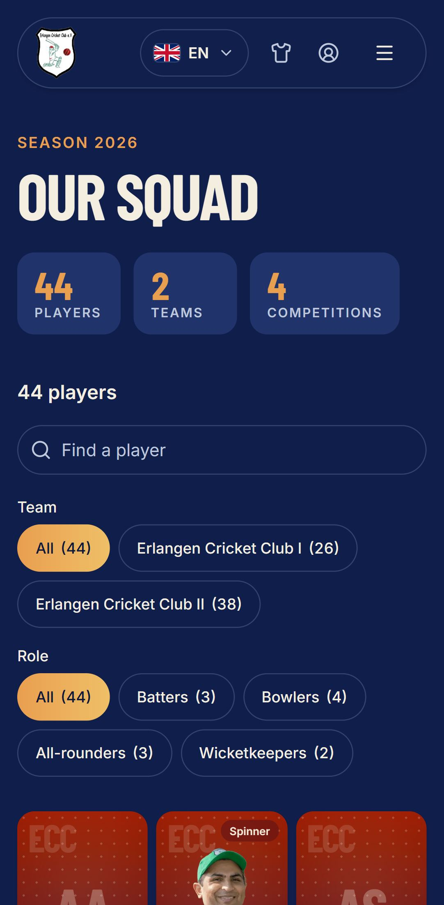
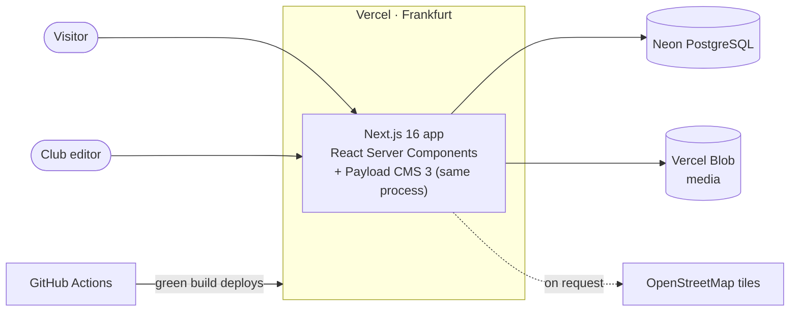

<div align="center">

# Erlangen Cricket Club

**A production website and content platform for a German cricket club. One developer, built to
team standards: architecture records, a strict test pipeline and a €0 running cost.**

**[Live site: erlangen-cricket-club.vercel.app](https://erlangen-cricket-club.vercel.app/)**

[](https://github.com/Saqibrafiq/erlangen-cricket-club/actions/workflows/ci.yml)




</div>

## At a glance

|                          |                                                                                                                                                               |
| ------------------------ | ------------------------------------------------------------------------------------------------------------------------------------------------------------- |
| **What**                 | Public website and editing platform for Erlangen Cricket Club e.V. (Bavaria): fixtures, league tables, player career stats, news, membership.                 |
| **Who uses it**          | Players on their phones at the ground, people new to Germany looking for a club, fans and sponsors, and club editors who are not developers.                  |
| **Stack**                | Next.js 16 (App Router, React Server Components, Server Actions) · React 19 · TypeScript (strict) · Payload CMS 3 · PostgreSQL · Tailwind CSS v4              |
| **Quality gates**        | 800+ unit and component tests · 16 Playwright E2E specs with axe on every page · 100% branch coverage of the cricket maths · architecture rules checked in CI |
| **Documented decisions** | Full [arc42](docs/arc42/README.md) documentation and 20+ [architecture decision records](docs/arc42/09-architecture-decisions/README.md)                      |
| **Running cost**         | €0: Vercel Hobby, Neon Postgres and Vercel Blob free tiers                                                                                                    |

## Screenshots

|                                                                                                                           |                                                                                               |
| ------------------------------------------------------------------------------------------------------------------------- | --------------------------------------------------------------------------------------------- |
|  |    |
| **Career stats.** Every rate is calculated from the stored counts; each season opens to show the figures for each team.   | **Fixtures & results.** Filterable by competition, status and result, with the club's record. |

<p align="center">
  
  &nbsp;&nbsp;
  
</p>
<p align="center"><b>Mobile first:</b> designed for a player at the ground, in three themes (Light, Dark and the club kit).</p>

## Highlights

### Product

- **Fixtures & results:** every competition of both club teams, filterable (with deep links), live countdown to the next match, saved grounds with maps. Editors import a season from a CSV template and review it before saving.
- **Standings:** league tables as published, updated by dropping in the league's CSV export.
- **Player profiles with career stats:** 43 players' records across seasons, formats (T20 / 50-over) and teams. Averages, strike rates and economy are always calculated, never typed in.
- **Editing on the website itself:** signed-in editors add, edit and delete players, seasons, news, sponsors and fixtures in place. In the player editor, photo backgrounds are removed in the browser, at no cost.
- **Bilingual** (English / German) throughout, including editor screens and structured data.

### Engineering

- **Modular monolith with vertical feature slices.** Each feature exposes one public `index.ts`. Dependency rules (`app → features → domain/shared`, never the reverse) are enforced by dependency-cruiser in CI.
- **Pure domain layer:** cricket maths (averages, strike rates, economy, best figures, season totals) has zero framework imports and 100% branch coverage. Stats are where bugs would hurt the site's credibility.
- **Server-first React:** Server Components by default and Server Actions for writes. Every action checks the session itself and writes through Payload's access control.
- **Validated at every edge:** Zod for forms, environment variables and search parameters.
- **Accessibility is a gate, not a goal:** WCAG 2.2 AA, axe runs on every E2E page in every theme, there is full keyboard support, and Motion respects `prefers-reduced-motion`.
- **Performance and SEO:** static rendering with on-demand revalidation from CMS hooks, self-hosted fonts, per-page metadata, hreflang, a sitemap, JSON-LD (`SportsOrganization`, `SportsEvent`, `NewsArticle`, `BreadcrumbList`), and generated share images (Open Graph) for the site, every player and every article.
- **Privacy by design (Germany):** no tracking cookies and therefore no cookie banner, a recorded consent flag before any player profile is published, and maps that load only on request.
- **One motion system:** shared Motion presets (springs, panels, collapses, animated lists, scroll reveals) used by every interactive component, instead of per-page animation code.

## Architecture



```
src/
  app/        routes only: compose features, no business logic
  features/   vertical slices (fixtures, standings, players, news, membership, …)
    <slice>/components  server/  domain/  index.ts ← the only public entry
  domain/     pure cricket logic, no framework imports
  shared/     design system (ui), utilities (lib), validated config
  cms/        Payload collections, access control, hooks, migrations, seed
  i18n/       locales, routing, messages (en, de)
```

The full picture is in the [arc42 documentation](docs/arc42/README.md): context, building blocks, runtime scenarios, deployment, cross-cutting concepts, quality scenarios and risks.

### Selected decisions

| Decision                                                                                                                         | Why                                                                                                                                              |
| -------------------------------------------------------------------------------------------------------------------------------- | ------------------------------------------------------------------------------------------------------------------------------------------------ |
| [Modular monolith on Next.js + Payload](docs/arc42/09-architecture-decisions/0001-modular-monolith-with-next-and-payload.md)     | One developer and a €0 budget do not justify the operational cost of separate services. Slice boundaries keep the codebase ready to split later. |
| [Schema changes via migrations only](docs/arc42/09-architecture-decisions/0004-database-schema-via-migrations-only.md)           | Reproducible databases from day one; production is never schema-pushed.                                                                          |
| [Player profiles need recorded consent](docs/arc42/09-architecture-decisions/0009-player-profiles-require-recorded-consent.md)   | GDPR Art. 7(1): consent must be traceable, so it is enforced by access control as well as in the UI.                                             |
| [Edit content on the website](docs/arc42/09-architecture-decisions/0015-edit-content-on-the-website.md)                          | Non-technical editors work where visitors look, while public pages stay statically rendered.                                                     |
| [Background removal in the browser](docs/arc42/09-architecture-decisions/0016-player-photo-background-removal-in-the-browser.md) | Cut-out player photos without a paid API: an ONNX model runs client-side.                                                                        |
| [Three themes, chosen in the browser](docs/arc42/09-architecture-decisions/0020-three-themes-chosen-in-the-browser.md)           | No flash of the wrong theme, and pages stay static: a tiny pre-paint script instead of per-request rendering.                                    |
| [Career stats from league season records](docs/arc42/09-architecture-decisions/0022-career-stats-from-league-season-records.md)  | A documented exception to "scorecards are the source of truth", scoped to the seasons without scorecards.                                        |

## Quality pipeline

Every pull request runs:

1. **Lint and types:** ESLint (typescript-eslint strict, jsx-a11y strict), `tsc` with `strict` and `noUncheckedIndexedAccess`.
2. **Architecture:** dependency-cruiser enforces the layer and slice rules.
3. **Unit and component tests:** Vitest and React Testing Library, querying by role (as users and assistive technology do). `src/domain` must reach 100% coverage.
4. **E2E and accessibility:** Playwright on phone and desktop against a production build and a seeded database, with axe checks in every theme.
5. **Lighthouse CI:** six key pages; accessibility, best practices and SEO must score at least 95 (they score 100), and performance is tracked as a warning.
6. **SonarCloud:** quality gate with the unit test coverage.
7. **Storybook build:** every shared UI component has stories for its variants and states.

Commits follow Conventional Commits (commitlint); staged files are linted and formatted on commit (Husky and lint-staged). Work is trunk-based: short-lived branches, a pull request, squash merge, then automatic deployment.

## Tech stack

| Concern             | Choice                                                             |
| ------------------- | ------------------------------------------------------------------ |
| Framework           | Next.js 16 (App Router, RSC, Server Actions, Turbopack), React 19  |
| Language            | TypeScript, `strict` and `noUncheckedIndexedAccess`                |
| CMS, auth and admin | Payload CMS 3, running inside the Next.js app                      |
| Data                | PostgreSQL: Neon in production, Docker locally                     |
| UI                  | Tailwind CSS v4 with design tokens, Radix primitives, lucide icons |
| Motion              | Motion (`motion/react`), with reduced motion respected             |
| Validation and i18n | Zod, next-intl (en, de)                                            |
| Testing             | Vitest, React Testing Library, Playwright, axe-core, Storybook     |
| Delivery            | GitHub Actions, Vercel (Frankfurt), Lighthouse CI, SonarCloud      |
| Monitoring          | Vercel Web Analytics and Speed Insights (cookieless)               |

## Running it locally

Prerequisites: Node.js 24, pnpm (via Corepack), Docker.

```bash
corepack enable
pnpm install
cp .env.example .env.local      # then set PAYLOAD_SECRET
pnpm db:up                      # PostgreSQL in Docker (host port 5433)
pnpm db:migrate                 # create the schema
pnpm db:seed                    # optional: 2026 fixtures, results, news and players
pnpm dev                        # http://localhost:3000 (German: /de, admin: /admin)
```

| Script                          | Purpose                                                   |
| ------------------------------- | --------------------------------------------------------- |
| `pnpm test` / `test:coverage`   | Unit and component tests (100% required for `src/domain`) |
| `pnpm test:e2e`                 | Playwright E2E with axe                                   |
| `pnpm lint` / `typecheck`       | ESLint / TypeScript                                       |
| `pnpm depcruise`                | Architecture rules                                        |
| `pnpm storybook`                | Component workshop on http://localhost:6006               |
| `pnpm db:migrate:create <name>` | New migration after a collection change                   |
| `pnpm db:import:player-seasons` | Load the league's season records (re-runnable)            |

Deployment and operations: [`docs/deployment.md`](docs/deployment.md).

## Author

Built by **Saqib Rafiq**, Senior Frontend Engineer, and also the club's chairman, so the product
owner was always in the room. [GitHub](https://github.com/Saqibrafiq)

## Licence

© 2026 Saqib Rafiq. All rights reserved. The code and design are proprietary and published for
viewing only; see [LICENSE](LICENSE). The club's name, crest, photos and texts belong to Erlangen
Cricket Club e.V.
