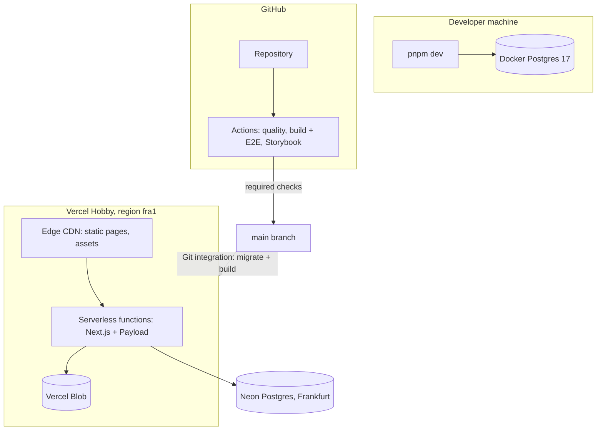

# 7. Deployment View

| Environment | Where                          | Database                                                     | Media            |
| ----------- | ------------------------------ | ------------------------------------------------------------ | ---------------- |
| Local       | `pnpm dev`                     | Docker Postgres on host port 5433 (`pnpm db:up`)             | `./media` folder |
| CI          | GitHub Actions                 | Ephemeral Postgres service, migrated and seeded before build | —                |
| Preview     | Off (ADR-0013); planned per PR | Neon branch per preview (planned)                            | Vercel Blob      |
| Production  | Vercel, `fra1` (Frankfurt)     | Neon, `aws-eu-central-1` (Frankfurt), pooled connection      | Vercel Blob      |

Schema changes ship as migrations in `src/cms/migrations/` ([ADR-0004](09-architecture-decisions/0004-database-schema-via-migrations-only.md)). Because pages are prerendered from the database, every build needs a reachable, migrated database. Vercel therefore runs `pnpm db:migrate && pnpm build` (`vercel.json`) and only builds production; `prodMigrations` on startup is the fallback ([ADR-0013](09-architecture-decisions/0013-production-on-vercel-and-neon.md)). Setup and day-to-day operations: [`docs/deployment.md`](../deployment.md).

Configuration is provided through environment variables, validated at startup; the canonical origin falls back to Vercel's production domain ([`src/shared/config/env.ts`](../../src/shared/config/env.ts)); see [`.env.example`](../../.env.example).
